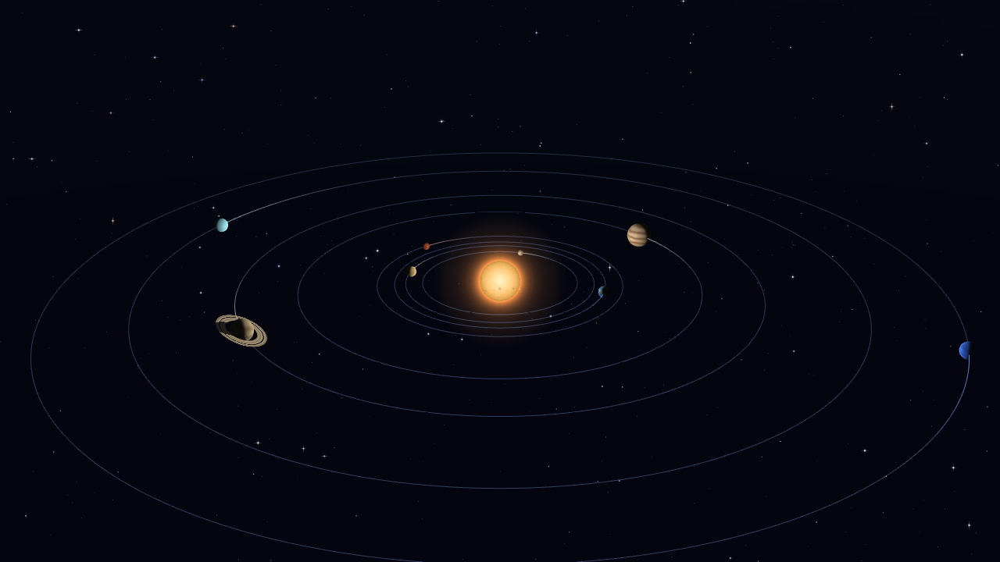
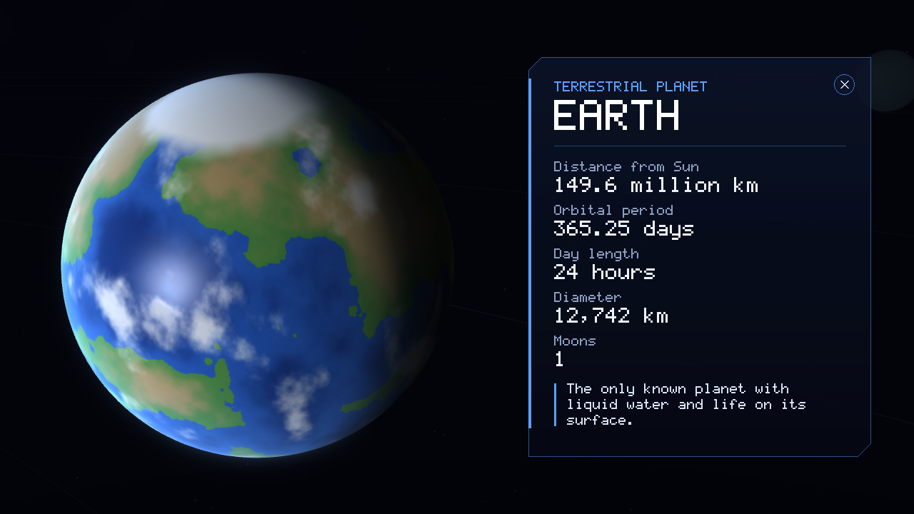
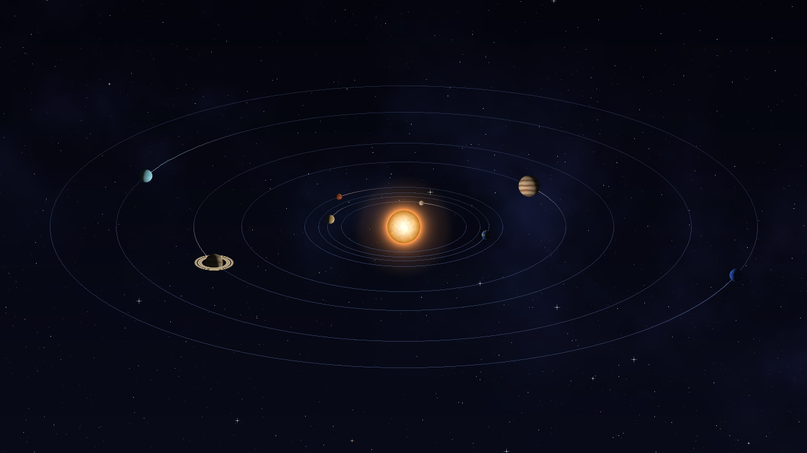
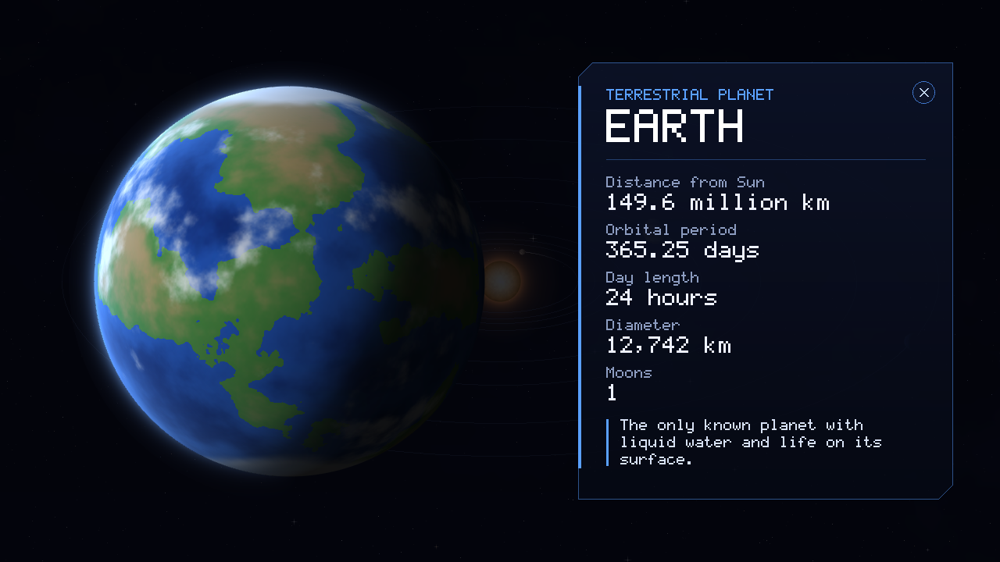
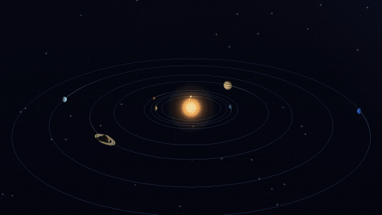
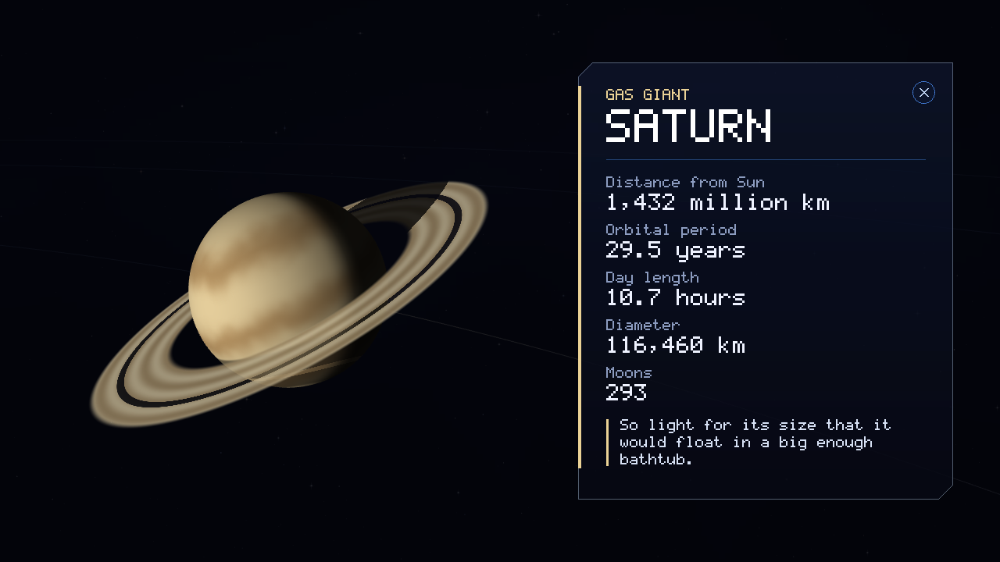
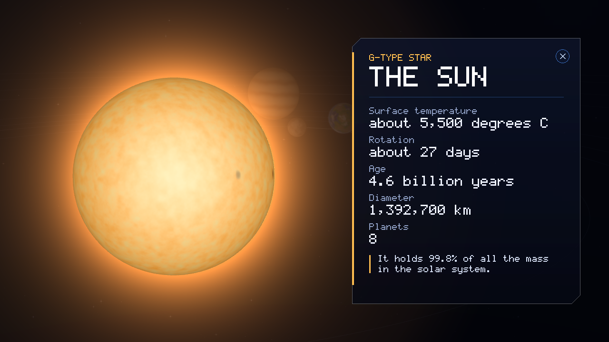

# Galaxis — Procedural Solar System Simulator

**Group 4** · Computer Graphics semester project · Nicole Kirimi, Bill Ritchie, Trevor James, Wesley Mutisya, Michael Wambari

Galaxis is an interactive model of the solar system: the Sun and eight planets orbiting at correct relative
speeds, spinning with a visible day/night line, lit by the Sun, and explorable with a camera you control.
Click any body and the camera flies in along a Bezier curve while a facts panel fades in.

| Checkpoint | What it is | Program |
|---|---|---|
| **CP1** Technical foundation | Scan-conversion algorithms from scratch in pure C++; every Galaxis component drawn with them | `galaxis_cp1` → images |
| **CP2** Transformation + animation | 2-D/3-D matrices, a true 3-D scene, orbit camera, Bezier fly-to; an animated GIF, still pure C++ | `galaxis_cp2` → images + GIF |
| **CP3** OpenGL prototype | Interactive OpenGL 3.3 app built on the CP1/CP2 code | `galaxis_cp3` → window |




---

## Quick start (Windows, VS Code terminal)

You need MinGW-w64 (`g++` and `gcc`), the same compiler used for CP1. Open the `galaxis` folder in VS Code,
open a terminal (**Terminal → New Terminal**), then run:

```powershell
.\build.bat cp3        # or cp1, cp2, all
.\galaxis_cp3.exe
```

- CP1 writes its images to `output\cp1`, CP2 writes images and `galaxis_cp2.gif` to `output\cp2`.
- `build.bat` compiles GLFW from the copy in `third_party`, so **nothing else needs installing**.
- **Can't build CP3?** `prebuilt\galaxis_cp3.exe` is the same program, ready to run (64-bit Windows 10/11).
  If Windows SmartScreen warns about an unknown app, choose *More info → Run anyway*.

### Linux / macOS

```bash
make cp1 cp2 cp3          # CP3: apt install libglfw3-dev  /  brew install glfw
./galaxis_cp3
```

CMake also works on every platform: `cmake -S . -B build && cmake --build build`.

---

## CP3 controls

The overview shows only the Sun, the planets, their orbits and the stars, with no text.

| Input | Action |
|---|---|
| Drag | Orbit the camera |
| Right-drag | Pan |
| Scroll | Zoom |
| **Click a planet or the Sun** | Camera flies in, facts panel fades in |
| Esc, the panel's ×, or click empty space | Fly back to the overview |
| 1 – 8, 0 | Jump to Mercury … Neptune, 0 = the Sun |
| Space | Pause / play |
| + / − | Faster / slower (1 to 365 days per second) |
| O | Orbit lines on / off |
| R | Reset the camera |
| F | Fullscreen |
| H | Show / hide the controls |
| Q | Quit |

---

## CP1 — Technical foundation

Pure C++17, standard library only. The program draws into its own framebuffer and writes `.bmp` files.

| Technique | Implementation | Used for |
|---|---|---|
| DDA line | `src/core/Line.cpp` | Panel divider, close button, grid lines |
| Bresenham line (all octants) | `src/core/Line.cpp` | Orbit trails, star spikes, outlines |
| Midpoint circle (8-way symmetry) | `src/core/Circle.cpp` | Planet and Sun discs (as spans), close button |
| Midpoint ellipse (4-way symmetry) | `src/core/Ellipse.cpp` | Orbits seen in perspective |
| Scanline polygon fill (ET + AET) | `src/core/Fill.cpp` | Panels, icons |
| Boundary fill, flood fill (4/8) | `src/core/Fill.cpp` | Demo sheet 04 |
| Cohen–Sutherland clipping | `src/core/Clip.cpp` | Clipping projected orbit segments to the screen (CP2) |
| 5×7 bitmap font with word wrap | `src/core/Font.cpp` | Facts panel, title card, help |
| Lambert shading, procedural noise | `src/core/Components.cpp`, `Texture.cpp` | Planet surfaces, day/night line |




Test sheets: [lines](docs/cp1/01_lines.png) · [circles](docs/cp1/02_circles.png) · [ellipses](docs/cp1/03_ellipses.png) ·
[fills](docs/cp1/04_fills.png) · [clipping](docs/cp1/05_clipping.png) · [components](docs/cp1/06_components.png)

## CP2 — Transformation and animation

Still pure C++. CP2 builds on CP1: every point now goes through real matrices,
**world → view (look-at) → clip (perspective) → NDC (÷w) → screen (viewport)**, and the scene is
drawn with the CP1 rasterisers using the painter's algorithm.

| Technique | Implementation | Used for |
|---|---|---|
| 2-D homogeneous matrices: translate, rotate, scale, reflect, shear, rotate/scale about a pivot | `src/core/Transform.cpp` (`Mat3`) | Sheet 07 |
| 3-D matrices: translate, scale, rotate X/Y/Z, rotate about any axis (Rodrigues) | `Transform.cpp` (`Mat4`) | Planet tilt × spin, ring plane |
| `lookAt`, `perspective`, `orthographic`, `viewport` | `Transform.cpp` | Camera, sheet 08 |
| Orbit camera (yaw, pitch, distance, pan) | `src/core/World.cpp` | Overview camera |
| Cubic Bezier fly-to with ease-in-out | `World.cpp` (`Galaxis::pose`) | Click-to-learn camera path |
| Ray casting: ray–sphere picking, ray–plane rings, ring and planet shadows | `World.cpp`, `src/cp2/Renderer3D.cpp` | Clicking, Saturn's rings |
| Painter's algorithm (depth-sorted segments and bodies) | `Renderer3D.cpp` | Visibility |
| Animation timeline, GIF encoder (median-cut palette, Bayer dither, LZW) | `src/cp2/main.cpp`, `Gif.cpp` | `galaxis_cp2.gif` |

The animation shows orbits and spin, the camera circling, and a scripted cursor clicking Earth, then Saturn:
each time the camera flies in, the panel fades in, the × is clicked and the camera flies back out.



[2-D transformations](docs/cp2/07_transform2d.png) · [3-D transformations and projection](docs/cp2/08_transform3d.png) ·
[3-D overview](docs/cp2/overview_3d.png) · [fly-in](docs/cp2/flyin_midway.png) · [Saturn](docs/cp2/focus_saturn.png)

## CP3 — OpenGL integration and prototype

GLFW window, OpenGL 3.3 core profile, GLSL shaders. The simulation, camera, picking and fly-to are the
**same CP2 code** (`src/core/World.cpp`). The planet, Sun, ring and sky textures are baked at start-up
from the **same CP1/CP2 procedural colour functions**, and the facts panel, title card and help are drawn
with the **CP1 rasterisers and font**, then uploaded as textures.

| Feature | Where |
|---|---|
| UV-sphere and ring mesh generation, VAOs/VBOs | `src/cp3/Renderer.cpp`, `GLUtil.cpp` |
| Phong-style lighting from the Sun: soft day/night terminator, Blinn-Phong specular on Earth's oceans, atmospheric rim | `src/cp3/Shaders.h` (`kPlanetFS`) |
| Sun with limb darkening and an additive corona billboard | `kSunFS`, `kGlowFS` |
| Saturn's rings with the planet's shadow on them and their shadow on the planet | `kRingFS`, `kPlanetFS` |
| Model matrix = translate × axial tilt × spin × scale (Uranus rolls on its side) | `Renderer::drawBody` |
| Orbit lines and fading trails (depth-tested lines) | `Renderer::drawOrbits` |
| Starfield (point sprites) and nebula sky (equirectangular texture) | `kStarVS/FS`, `kSkyFS` |
| Ray-cast picking, Bezier fly-to, dimmed background, fading facts panel | `src/cp3/App.cpp`, `World.cpp` |
| Animated intro, help overlay, status toasts, high-DPI support | `App.cpp`, `Renderer.cpp` |




---

## Project layout

```
include/galaxis/      shared headers
src/core/             shared by all checkpoints
  Canvas, Line, Circle, Ellipse, Fill, Clip, Font   CP1 rasterisers
  Components, Texture, Planet, Facts                CP1 components, procedural colours, data
  Transform, World                                  CP2 matrices, simulation, camera, fly-to, picking
src/cp1/              CP1 scene + test sheets + main
src/cp2/              CP2 software 3-D renderer, GIF encoder, test sheets + main
src/cp3/              CP3 OpenGL renderer, shaders, app logic, GLFW main
third_party/          GLFW 3.4 (zlib licence), GLAD loader (generated)
prebuilt/             galaxis_cp3.exe for Windows
build.bat  Makefile  CMakeLists.txt
```

## Notes

- **Scale:** distances use a square-root scale and planet sizes are exaggerated. At true scale, Neptune would sit 78 times farther out than Mercury and the planets would be invisible dots. The facts panel shows the real values.
- **Spin:** real rotation periods range from 10 hours to 243 days. On screen they are compressed (fourth root) to 3–16 seconds per turn, keeping the order: Jupiter fastest, Venus slowest and backwards.
- **Facts:** NASA mean values. Moon counts are NASA's known-moon counts as of mid-2026; Jupiter and Saturn keep gaining newly confirmed moons, so check `src/core/Facts.cpp` before the final demo.
- **OpenGL 3.3** is supported by practically every GPU since 2010. In a virtual machine or over Remote Desktop it may not be available.

## Troubleshooting

| Problem | Fix |
|---|---|
| `g++` or `gcc` not recognised | Install MinGW-w64 (e.g. MSYS2, then `pacman -S mingw-w64-ucrt-x86_64-gcc`) and add its `bin` folder (`C:\msys64\ucrt64\bin`) to PATH. Restart VS Code. |
| `build.bat` not recognised in PowerShell | Type it with the dot: `.\build.bat cp3` |
| "Could not open an OpenGL 3.3 window" | Update the graphics driver, or run on the real machine rather than a VM / Remote Desktop. |
| CP3 build fails but you need to demo | Run `prebuilt\galaxis_cp3.exe`. |
